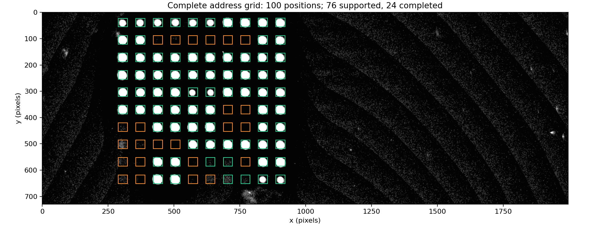

# Complete addressing of convective PCR fluorescence arrays

This repository accompanies our study of temporal aggregation and joint image–geometry registration for fluorescence-array addressing in convective PCR. The method combines a temporally aggregated reference image, background and contrast correction, YOLO spot detection, and bounded lattice registration to infer the full row–column address grid, including weak sites without matched detector candidates.

## Run one 10 × 10 example in Google Colab

[](https://colab.research.google.com/github/ShuoYang-buct/convective-pcr-array-addressing/blob/main/Run_in_Colab.ipynb)

Click the button, then choose **Runtime → Run all**, or run the cells from top to bottom. The notebook automatically installs dependencies, downloads and checks the paper model, and loads one example sequence (**N008**, 10 × 10).

Each stage is displayed:

1. Original acquired image.
2. Temporal maximum projection of ten selected raw frames.
3. Background subtraction and contrast enhancement.
4. YOLO detection boxes from a new model inference.
5. Filtered and size-normalized candidate boxes.
6. Complete 100-address grid: candidate-supported boxes in green and inferred boxes in orange.
7. Downloadable stage images, final overlay, address table and QC summary.

The default demonstration runs the actual YOLO model. A CPU works; a GPU is optional. A complete grid indicates that all specified addresses are output, while the printed QC status reports whether the grid meets the automatic acceptance checks.

## Example output



The reference run retains 76 candidate-supported addresses and infers 24 additional addresses, giving the full 100-position grid. Green and orange distinguish these two groups.

## Included data and code

Only one 10 × 10 sequence is included. Its ten selected full-field frames are losslessly encoded PNGs with unchanged acquired grayscale pixels. The source acquisition contains 60 frames; the subset follows the paper's five-earlier/five-final-ten selection rule. Preprocessing runs on the full field before applying the fixed crop. The repository does not include the other 33 sequences, training data or the private engineering application. Manual center coordinates are not required or loaded by the demonstration.

The minimal implementation is in `src/`; the Colab notebook exposes the processing steps. Model weights are distributed through the [v1.0.0 Release](https://github.com/ShuoYang-buct/convective-pcr-array-addressing/releases/tag/v1.0.0), with their SHA-256 recorded in `model_manifest.json`. Image materials were provided by Torus (Shanghai, China).

## Run locally

```bash
python -m pip install -r requirements.txt
# Download best.pt from the Release into weights/.
python demo_pipeline.py --weights weights/best.pt
```

Results are written to `outputs/demo/`.

## Licensing

No project-wide license is specified for the author-provided code, weights or example images. Dependencies, including Ultralytics, retain their own licenses.
